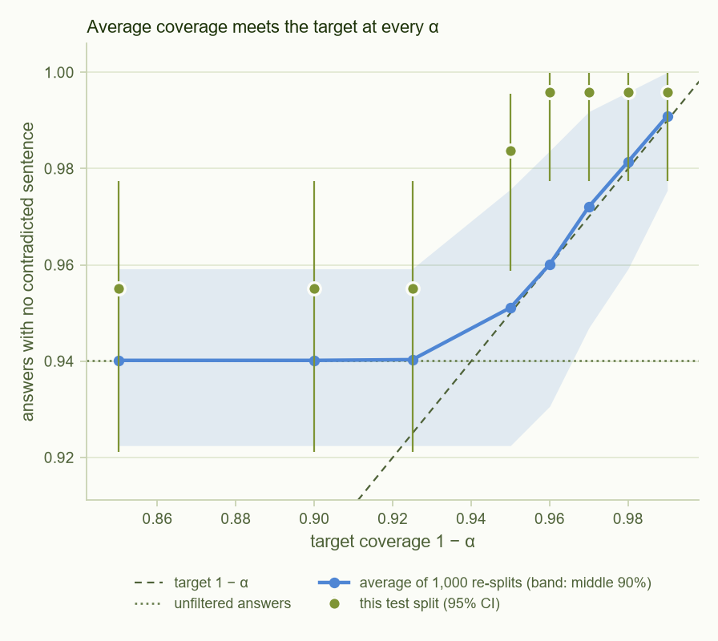
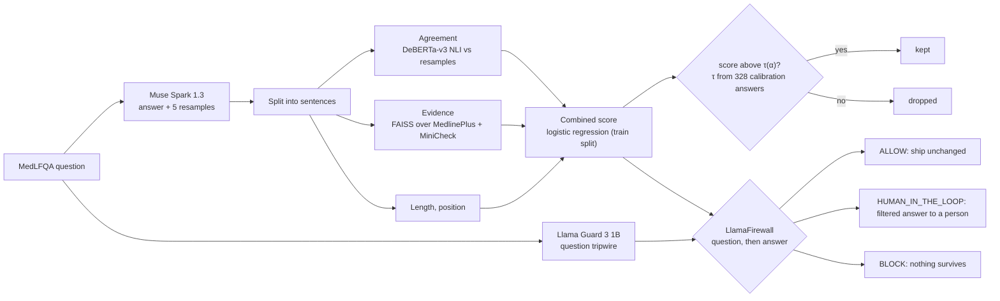
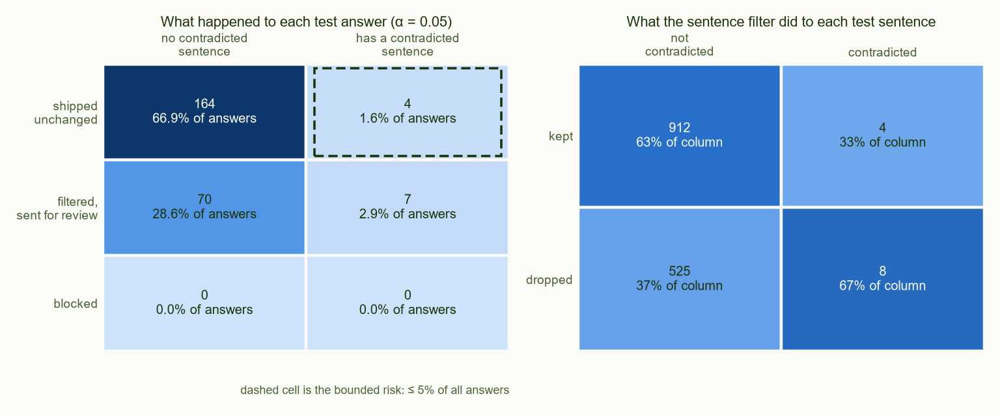
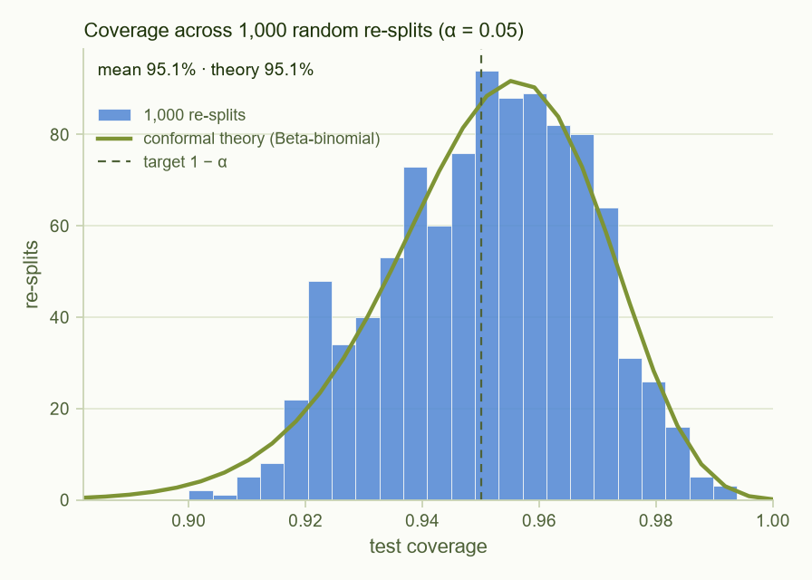
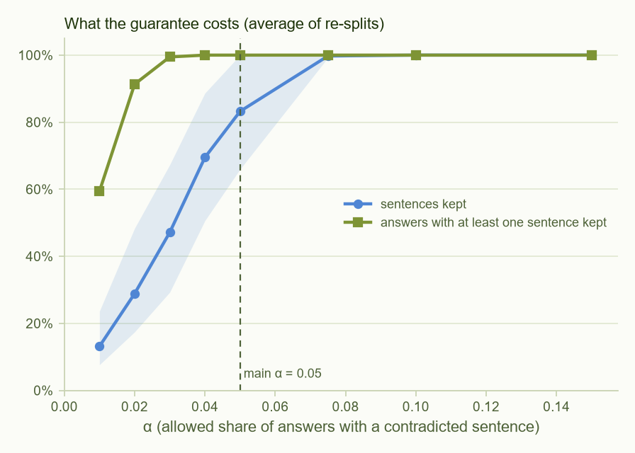
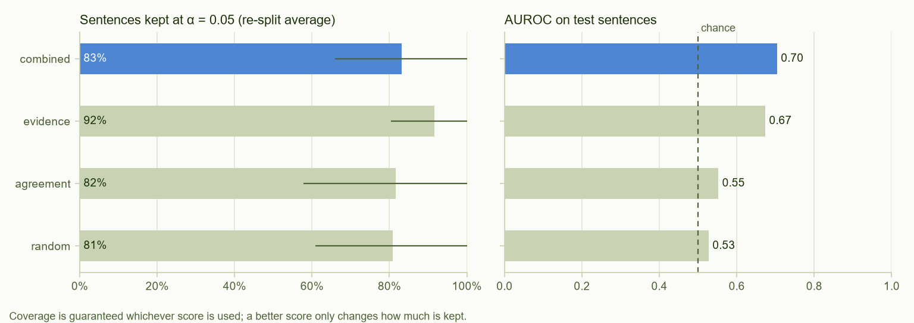
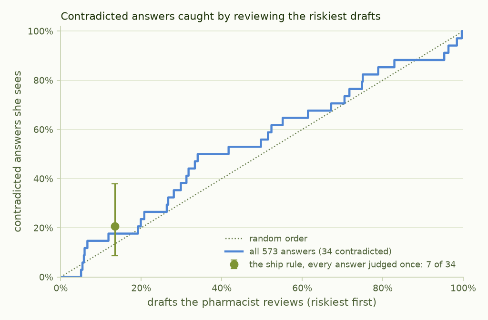
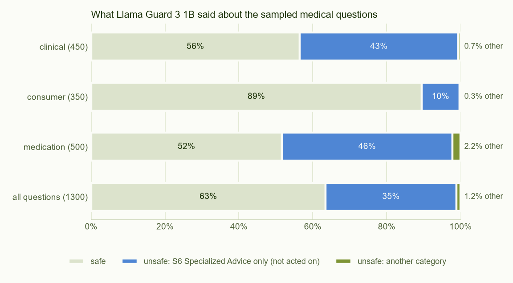

# Conformal Guard

**Hackathon theme: Build for Your World.** It frees up a pharmacist's time: instead of checking every medical answer Muse Spark drafts, she checks about 1 in 6, and the rest go out under a calibrated bound on how often they contradict the reference answer.

**A guardrail that lets a pharmacist set how often Muse Spark's unchecked medical drafts may contradict the reference answer, and tells her how many drafts she must read to keep that bound.**

Language models state wrong medical facts in the same confident tone as right ones, and a detector that is "usually right" doesn't say how often what it lets through is wrong. Conformal Guard puts a statistical guarantee on top of a weak black-box detector: it removes the sentences it is least sure of, and it is calibrated on held-out data so that **at least 95% of filtered answers contain no sentence that contradicts the MedLFQA reference answer**, as judged by an automatic label pipeline. It runs as a **LlamaFirewall** scanner that ships an answer, sends it to a pharmacist with the doubtful sentences marked, or blocks it.

### Who it's for

A pharmacist at a telehealth service whose AI assistant drafts answers to medication questions. She can't read every draft, and wrong answers sound as confident as right ones. Without a guard she has two options: read everything, or let drafts out at an error rate nobody has measured. Conformal Guard gives her a third: she sets the bound (here, at most 5 in 100 drafts go out with a contradiction), and it tells her how many drafts she must read to keep it. Per 100 drafts, averaged over 1,000 re-splits of all 573 held-out answers:

- **About 83 go out without her reading them, and 4.7 of the 100 went out with a contradiction**, inside the bound of 5; without the guard it would be 5.9. The bound is an average over questions like these, and it holds whatever the detector, because it comes from calibration on answers the detector never saw.
- **About 17 go to her review queue**, with the doubtful sentences marked, each beside its MedlinePlus evidence and the passage of the reference answer it conflicts with. The marks are hints: the score leans on sentence position, so she reads the whole draft.
- **Every decision carries a certificate:** the bound, the calibration set it rests on, and why this draft shipped, went to her or was blocked. The service has a written record of what it promised.
- **Questions about self-harm never reach the answer stage:** Llama Guard sends them straight to a person.

**What it doesn't do yet: pick the right drafts.** The current score barely tells contradicted answers from clean ones (answer-level AUROC 0.54, 95% CI 0.44–0.64), so her queue is close to a random sample of the right size: a calibrated spot-check. On the test split the queue looked targeted (7 of 11 contradicted answers), but that didn't replicate ([below](#does-the-review-queue-hold-up)). The guarantee doesn't depend on the score, so a better one plugs into the same LlamaFirewall scanner and shrinks her queue without changing the promise.

The pharmacist is an illustrative user; everything above is measured on a public benchmark, with no personal data. Conformal Guard doesn't advise patients itself: it decides which AI drafts a professional checks, and bounds how often an unchecked one contradicts the reference answer.

| | |
|---|---|
| **Live demo** | *GitHub Pages link: added at submission* (or open [`docs/index.html`](docs/index.html) locally) |
| **Video** | *link added at submission* |
| **Model** | Muse Spark 1.3 (`muse-spark-1.3`) through the Meta Model API |
| **Data** | 819 MedLFQA questions: 246 to fit the score, 328 to calibrate, 245 held out to test |
| **Track** | Indie developer (solo) |

### Results at a glance (main setting, α = 0.05, held-out data only)

| | |
|---|---|
| Test answers with no contradicted sentence | **98.4%** after filtering (95% CI 95.9–99.6%), against a 95% target; **95.5%** before filtering |
| Shipped unchanged while containing a contradiction | **1.6%** of test answers (bound: 5%); over 1,000 re-splits of all 573 held-out answers, **4.7%** on average (5.9% without the guard) |
| The pharmacist's review queue | **31%** of test answers, holding 7 of 11 contradicted ones; **not replicated**: with every held-out answer judged once, 7 of 34 (21%, 95% CI 9–38%) in a queue of 13% |
| Sentences kept by the filter | **63%** at the calibrated threshold; 83% averaged over 1,000 re-splits, where a random score keeps 81% |
| What the filter drops | the **first sentence of every test answer**: the learned score mostly encodes sentence position |
| Implementation check | 1,000 random re-splits average 95.1% coverage; conformal theory predicts 95.1% |
| Label audit by hand | 6 of 13 flags real under the rule used (46%, 95% CI 19–75%); 10 of 59 under the broad rule (17%, 8–29%) |

**In short:** the guarantee holds, but at α = 0.05 it has little to do, because unfiltered answers are already 94–95.5% clean by these labels. Our black-box score is weak on these labels and learned mostly sentence position, so the filter's main effect is to drop each answer's opening sentence, and a random score keeps about as many sentences for the same guarantee. What holds is the bound on what ships unchecked, which is what the pharmacist relies on: over 1,000 re-splits, 4.7% of answers shipped with a contradiction, against 5% (5.9% without the guard). Which drafts are held back is close to random with this score: the test split suggested otherwise (7 of 11 contradicted answers in a third of the drafts), but that didn't replicate. See [Limitations](#limitations).



---

## What it guarantees

Each answer is split into sentences. Each sentence gets a score; the filter keeps sentences whose score is above a threshold τ. τ is not tuned by hand: it is set on 328 calibration answers so that, for a new question drawn like those,

> **P(the filtered answer contains no sentence labelled as contradicting the reference answer) ≥ 1 − α**

where the probability is over the new question **and** the calibration set. This is the split-conformal guarantee of Mohri & Hashimoto (2024), and it holds for **any** score, good or bad. The score only decides how much has to be removed to meet it.

What it does **not** say:

* It is **marginal**: an average over questions like MedLFQA's, not a promise about one answer. A single test set of 245 answers can land anywhere from 92.2% to 97.6% (middle 90% of re-splits); the average is what is guaranteed.
* It does **not** hold for a subset the system picks. Answers sent to review are picked by the system, so the 95% is not guaranteed for them (on the test split, 75 of 77 filtered review answers, 97.4%, were clean).
* It is **about the labels used**. "Contradicts" means an NLI model finds a specific passage of the MedLFQA reference answer in conflict with the sentence. Most of these references were not written by doctors ([below](#where-the-reference-answers-come-from)), and we audited the labels by hand ([below](#labels-and-the-hand-audit)). It says nothing about errors the reference doesn't address: about 80% of test sentences are neither supported nor contradicted by it.
* It assumes **exchangeability**: new questions like the calibration ones. A similarity check sends questions unlike the calibration set to a person, but in practice it mostly flags very short questions ("whats zithromax"), and passing it doesn't make a question exchangeable. A Llama Guard tripwire also stops explicit self-harm and weapons questions before they reach the guard.

### The math, briefly

For calibration answer *i*, let *r*ᵢ be the highest score among its contradicted sentences (−∞ if it has none). With *n* calibration answers, let τ be the *k*-th smallest *r*ᵢ, *k* = ⌈(*n*+1)(1−α)⌉. Keeping only sentences scoring above τ removes every contradicted sentence of a new answer exactly when *r*ₙ₊₁ ≤ τ, and by exchangeability that happens with probability at least *k*/(*n*+1) ≥ 1−α. Given the calibration set, test coverage follows a Beta(*k*, *n*+1−*k*) distribution, so over random re-splits it is Beta-binomial; [`resplits.png`](results/figures/resplits.png) checks that prediction against 1,000 re-splits. Random re-splits of one pool reproduce this distribution for any score, even a random one, so the check confirms the implementation, not that the filter is useful.

Two more calibrated layers sit on top:

* **Ship rule** (conformal risk control, Angelopoulos et al. 2024): an answer is sent unchanged when its weakest sentence clears a second threshold λ, chosen so that the expected share of *all* answers that are *shipped while containing a contradiction* is at most α. For the answers that do ship, that implies a contradiction rate of at most about α / P(ship) ≈ 7.3% at the observed 68.6% ship rate. Bounding that rate directly, as Conformal Alignment does (Gui et al. 2024), is the stronger guarantee. λ (0.971) is below τ (0.990), so a shipped answer can contain sentences the filter would drop; on the test split, all 168 shipped answers did.
* **Learn-Then-Test** (Angelopoulos et al. 2021): a stricter threshold that holds with 95% confidence over the calibration draw, not just on average; reported alongside.

## How it works



1. **Answer and resample.** Muse Spark answers each question once, plus five resamples with the same settings (`reasoning_effort: minimal`, temperature 1.0, `developer` instruction role). The API rejects `logprobs` with reasoning models, so every score is black-box.
2. **Split.** A fixed rule-based splitter turns the answer into sentence claims (at least 4 words), so calibration and deployment see identical units. Only 0.5% of answer text falls outside a scored sentence.
3. **Score.**
   * *Agreement*: mean NLI entailment of the sentence by each resample (self-consistency, in the spirit of SelfCheckGPT).
   * *Evidence*: the question and sentence retrieve the top 3 MedlinePlus passages (15,575 passages from 1,016 health topics, `bge-small` embeddings, **FAISS**), and MiniCheck-Flan-T5-Large scores whether they support the sentence.
   * Sentence length and position. A logistic regression fit on the 246 training answers only combines these into one score. Position ended up dominating it (see [Limitations](#limitations)).
4. **Calibrate** τ for each α on the 328 calibration answers (`calibrate.py`), and λ for the ship rule.
5. **Decide**: ship, filter and send for review, or block (`guard.py`), as a LlamaFirewall scanner. A similarity check compares the question with the calibration questions and sends outliers to a person. In the same LlamaFirewall, **Llama Guard 3 1B** screens the question first (`question_guard.py`): explicit self-harm goes to a person, and weapons or child-exploitation questions are blocked before any answer is checked ([below](#question-side-tripwire-llama-guard-3-1b)).

Reference labels come from a separate NLI pass of each sentence against the MedLFQA reference answer and its must-have / nice-to-have statements. They are used only to calibrate and evaluate, never as a score.

### Where the reference answers come from

MedLFQA (Jeong et al. 2024) rebuilt five question sets into one format, and their reference answers have different origins. On the 245 test answers:

| Source | Test answers | Reference answer |
|---|---|---|
| K-QA golden | 34 (14%) | written by physicians |
| K-QA silver | 52 (21%) | generated with GPT-4 by the MedLFQA authors |
| HealthSearchQA | 48 (20%) | generated with GPT-4 by the MedLFQA authors |
| MedicationQA | 93 (38%) | text taken from health websites (DailyMed, MedlinePlus and others) |
| LiveQA | 18 (7%) | existing answers from the original dataset, taken from health websites |

The must-have and nice-to-have statements the labels also use were generated with GPT-4 for every source except K-QA golden; the MedLFQA authors had medical experts review a sample. So for 86% of test answers, "contradicts the reference" means contradicting a curated or GPT-4-written answer, not a doctor's.

## Results

All numbers are on data the score and thresholds never saw. Full tables: [`results/summary.md`](results/summary.md) (main) and [`results/v2_labels/summary.md`](results/v2_labels/summary.md) (sensitivity).

**What happened to each test answer.** Left: the decision against whether the answer really contains a contradicted sentence; the dashed cell (shipped and wrong: 4 answers, 1.6%) is the one the ship rule bounds at 5%. On this split, shipped answers contain a contradiction 2.4% of the time and reviewed ones 9.1%; that difference didn't replicate ([below](#does-the-review-queue-hold-up)). Right: the sentence filter keeps 63% of fine sentences and drops 8 of the 12 contradicted ones on this split.



**What the filter drops.** At α = 0.05 the threshold falls between the first and last sentences of every answer: on the test split it keeps 0 of 245 first sentences and all 245 last sentences (rank correlation between score and position: 0.87). First sentences usually carry the direct answer, and the filter keeps reference-supported sentences less often (55%) than unverifiable ones (66%). The calibration split also happened to contain more contradictions than the test split (7.0% vs 4.5% of answers), so its threshold is stricter than in most re-splits: 63% of test sentences kept against an 83% re-split average.

**Implementation check: 1,000 re-splits.** Mean coverage 95.1% against a predicted 95.1%, and the histogram follows the Beta-binomial curve. Any correctly implemented conformal filter does this, so it checks the code, not the method.



**The price of strictness** (re-split averages): sentences kept, and answers left with at least one sentence, at each α. Where unfiltered answers are already clean enough (α ≥ 0.075 here), the filter correctly does nothing.



**Which scores matter.** Each score calibrated separately to the same guarantee; coverage holds for all of them, including a random score.



| Score | AUROC on test sentences (95% CI) | Sentences kept at α = 0.05, re-split average (middle 90%) |
|---|---|---|
| combined (used) | 0.70 (0.53–0.84) | 83.2% (66.0–100%) |
| evidence only | 0.67 (0.48–0.84) | 91.6% (80.4–100%) |
| agreement only | 0.55 (0.38–0.71) | 81.6% (57.8–100%) |
| random | 0.53 | 80.9% (60.9–100%) |

The AUROC intervals come from a bootstrap over test answers, because there are only 12 contradicted test sentences. They overlap (combined minus evidence: +0.03, −0.12 to +0.21), so the test data supports no ranking of the scores. The middle-90% ranges show how retention varies across re-splits; they are not confidence intervals.

Other modes at α = 0.05 on the test set: Learn-Then-Test (95% confidence) 99.6% coverage keeping 28.6% of sentences. Per-group (Mondrian) thresholds hold in every group (clinical 100%, consumer 95.5%, medication 100%) but keep far less in clinical (27.5% of sentences) and medication (34.2%), where each group's calibration set has only a few flagged answers; with 3, 4 and 4 contradicted test answers per group, these numbers are too small to compare. The ship rule sends 68.6% of answers unchanged and 31.4% to review.

### Does the review queue hold up?

On the test split, the queue held 7 of the 11 contradicted answers. That rests on 11 answers, so we re-ran the same rule on more data ([`triage_check.py`](triage_check.py), [`results/triage_check.md`](results/triage_check.md)). The score is fitted on the training answers only, so the 328 calibration answers are as unseen as the 245 test ones. Nothing is re-tuned, and this check was added after the test results were seen.

| Judged answers | Calibrated on | Sent to review | Contradicted answers in the queue (95% CI) | Shipped with a contradiction |
|---|---|---|---|---|
| 245 test (the headline) | 328 calibration | 31% | 7 of 11 (31–89%) | 1.6% |
| 328 calibration (swapped) | 245 test | 0% | 0 of 23 (0–15%) | 7.0% |
| **All 573, each judged once** | the other half | 13% | **7 of 34 = 21% (9–38%)** | 4.7% |
| 1,000 random re-splits (mean) | 328 random | 17% | 21% (middle 95%: 0–57%) | **4.7%** (middle 95%: 2.0–8.2%) |

* **The triage doesn't replicate.** Ranked by their weakest sentence, all 573 answers give an AUROC of 0.54 (95% CI 0.44–0.64; 0.64 on the test split alone). Reviewing the riskiest 30% catches 13 of 34 contradicted answers (38%, 95% CI 22–56%), where a random 30% would catch about 30%.
* **The size of the queue comes from the calibration data.** The test half has 4.5% contradicted answers, already under the 5% bound, so calibrated on it the rule ships everything; that half then shipped 7.0% with a contradiction. The bound is an average over calibration sets, and over the re-splits it held: 4.7%.
* **What this means for the pharmacist.** The guard tells her how many drafts she can skip and keeps the unchecked ones under the bound, but with this score, which drafts she gets is close to random. A random hold-back of the same size would do about as well.



### Sensitivity check: the broad labels

With the original, broader labels (v2: 18.4% of raw test answers flagged), at α = 0.10 the filter reaches 93.5% test coverage (unfiltered 81.6%), re-splits average 90.2% against a predicted 90.3%, and **the combined score clearly beats random: 58.8% of sentences kept against 37.1%** at the same guarantee (middle-90% ranges 52.6–66.4% and 29.5–43.2%). Agreement alone is no better than chance here (AUROC 0.50). Most v2 flags are false alarms (17% real in the audit), so this shows the score tracks the label pipeline, not necessarily real disagreements.

### Question-side tripwire (Llama Guard 3 1B)

Llama Guard reads only the question, so it needs no Muse Spark call: it ran over all 1,300 sampled questions, a median 0.15 s each on the RTX 4060. It labels 35.4% of them "unsafe: S6 Specialized Advice" (46% of medication questions, 43% of clinical, 10% of consumer), and it rated the dataset's overdose and pathogen questions safe or S6, including the two that triggered the Model API's content filter. Every in-scope question a broader policy stops is ordinary, for example "what color is 30mg prednisone" labelled S1 Violent Crimes. So the tripwire acts only on S11 Suicide & Self-Harm (to a person) and S4 or S9 (blocked); every other category is recorded and passed on to the conformal guard.

| Policy (what Llama Guard's labels trigger) | In-scope questions stopped (of 819) | Outside the frozen set (of 481) |
|---|---|---|
| **Tripwire (used): S11, S4, S9** | **0** | 0 |
| Every category except S6 | 11 (1.3%) | 4 (0.8%) |
| Every category | 306 (37.4%) | 169 (35.1%) |
| Every category, with S6 removed from Llama Guard's prompt (first attempt) | 267 (32.6%) | 148 (30.8%) |

The last row is why S6 stays in the prompt: without it, the model relabelled medical questions as S1 Violent Crimes. The policy was chosen after this check on the 1,300 questions and before eight hand-written probes, which it handled as follows: all three explicit self-harm questions went to a person, one of two mass-harm questions was blocked (an anthrax question came back as S1, which the tripwire does not act on), and all three ordinary questions passed. Full results: [`results/question_screen_llama_guard.md`](results/question_screen_llama_guard.md).



## Labels and the hand audit

A sentence is labelled *supported* if the reference answer or its statements entail it, *contradicted* if they contradict it, otherwise *unverifiable* (NLI: `DeBERTa-v3-large-mnli-fever-anli-ling-wanli`). The first, broad rule (v2: full reference contradicts the sentence with p ≥ 0.7) flagged 20.6% of answers. Before calibrating anything, we checked the flags by hand:

* 59 flagged sentences from the **training split only**, plus 15 unflagged ones mixed in so the judge could not tell which were flagged. One annotator (the author) judged each only against the reference ("does it say something incompatible?"), not against medical knowledge.
* **v2 flags were mostly false alarms: 10 of 59 real (17%, 95% CI 8–29%).** Unflagged checks: 0 of 15 real.
* Narrower rules computed on the same sentences. The one we adopted, **`local`**, keeps a flag only if one specific two-sentence passage of the reference contradicts it (p ≥ 0.9) and no passage supports it: **6 of 13 real (46%, 19–75%)**, at the cost of missing some real disagreements (it kept 6 of the 10 found). Because it was picked from five rules on these same sentences, the 46% is optimistic.
* The rule was chosen from label quality alone, before any calibration result was seen, and the audit used only training data.

Why both label sets are reported: false alarms only make a conformal filter stricter than needed, so v2's guarantee carries over to real disagreements as long as v2 rarely misses them. `local` labels mean more per flag but miss some, which weakens the guarantee for real disagreements by at least the share of answers containing a missed one: about 1–2 points from the misses the audit saw. How many real disagreements v2 itself misses is not measured; 0 of 15 unflagged sentences only bounds it below about 22% (95% upper limit).

Verdicts: [`results/label_audit.csv`](results/label_audit.csv). Code: [`audit_labels.py`](audit_labels.py).

## Built with Meta AI

| Component | Role |
|---|---|
| **Muse Spark 1.3** via the **Meta Model API** | Every answer and resample (4,914 generations for the 819 frozen questions). OpenAI-compatible client, `developer` role, `reasoning_effort: minimal`. [`probe_api.py`](probe_api.py) documents what the API accepts (e.g. no `logprobs`, `n = 1`). |
| **LlamaFirewall** | The guard is a registered custom scanner (`conformal_guard`): ship → `ALLOW`, review or out-of-domain → `HUMAN_IN_THE_LOOP_REQUIRED`, nothing survives → `BLOCK`. |
| **Llama Guard 3 1B** | Question-side tripwire in the same LlamaFirewall ([`question_guard.py`](question_guard.py)): S11 self-harm → `HUMAN_IN_THE_LOOP_REQUIRED`, S4 and S9 → `BLOCK`, other categories recorded and passed on to the conformal guard. |
| **FAISS** | Nearest-neighbour search over the MedlinePlus evidence index. |

Also used: DeBERTa-v3 NLI (agreement and labels), MiniCheck (evidence support), BAAI `bge-small-en-v1.5` (retrieval embeddings), scikit-learn, SciPy. Everything after generation runs locally on a laptop GPU (RTX 4060, 8 GB).

### Using the guard

```python
from llamafirewall import AssistantMessage, LlamaFirewall, Role, UserMessage
from guard import register_scanner, last_result

fw = LlamaFirewall(scanners={Role.ASSISTANT: [register_scanner()]})
result = fw.scan(AssistantMessage(content=answer), trace=[UserMessage(content=question)])
print(result.decision)                 # ALLOW / HUMAN_IN_THE_LOOP_REQUIRED / BLOCK
print(last_result()["certificate"])    # the guarantee that applies, in plain language
```

With the question tripwire in front, one LlamaFirewall holds a scanner per role and replays the conversation; it stops at the first `BLOCK` or `HUMAN_IN_THE_LOOP_REQUIRED`:

```python
from llamafirewall import AssistantMessage, LlamaFirewall, Role, UserMessage
from guard import register_scanner
from question_guard import register_question_scanner

fw = LlamaFirewall(scanners={Role.USER: [register_question_scanner()], Role.ASSISTANT: [register_scanner()]})
result = fw.scan_replay([UserMessage(content=question), AssistantMessage(content=answer)])
```

Llama Guard 3 1B is gated: accept Meta's licence on its Hugging Face page, then run `hf auth login` once.

The scanner needs five resamples of the question from the same model and settings. In this repository they come from the cached generations (replay); `guard.py` also has a live path through the Meta Model API, off unless `CG_LIVE=1`. `python guard.py --check 25` confirms the guard reproduces the calibrated scores exactly (max difference 0.00007 over 149 sentences, identical keep/drop decisions).

## Reproduce

Python 3.12, Windows or Linux, an NVIDIA GPU recommended (CPU works, slowly).

```bash
python -m venv .venv && .venv\Scripts\activate          # Linux: source .venv/bin/activate
pip install -r requirements.txt
pip install --no-deps llamafirewall==1.0.3                # its optional code scanner needs semgrep
python check_env.py --models

python generations_archive.py --restore   # cached Muse Spark answers -> cache/generations (no API key needed)
python label_claims.py                    # sentence claims, v2 labels, agreement score   (~12 min on GPU)
python audit_labels.py --apply local      # apply the audited label rule (verdicts are in results/)
python build_index.py                     # MedlinePlus evidence index (FAISS)              (~1 min)
python score_claims.py                    # MiniCheck evidence score                        (~10 min)
python calibrate.py --alpha 0.05          # thresholds, every result and figure -> results/
python calibrate.py --labels v2 --alpha 0.10   # sensitivity run -> results/v2_labels/
python triage_check.py                    # does the review queue hold up on all held-out answers? -> results/
python -m pytest -q tests                 # conformal coverage simulation, combiner, decisions, question tripwire
python guard.py --firewall --id clinical-5236b1a885   # one test answer through LlamaFirewall
python question_guard.py --eval          # Llama Guard question screen -> results/ (gated model, see above)
python build_demo.py                      # docs/ (open docs/index.html)
```

Generating answers from scratch (`prepare_data.py`, `generate.py`, `resplit.py`) needs a Meta Model API key in `.env`; see [`.env.example`](.env.example). The question set, split and seeds are frozen in `data/questions_final.jsonl` and [`config.yaml`](config.yaml).

## Limitations

* **Replay, not live.** All answers were generated on Oct 26, 2026. During generation, two questions (about overdose and a dangerous pathogen) triggered the API's content filter, and the developer account was then automatically restricted; an appeal is pending. We made no further API calls, and no other model generated answers. We added a pre-generation screen ([`screen.py`](screen.py)) that removes 14 questions of that kind, and froze the 819 questions whose six samples had all completed, randomly re-split 30/40/30 (stratified by group). Refused, content-filtered and screened questions (overdose, self-harm, dangerous pathogens) are outside the population the guarantee covers.
* **The filter has little to do at α = 0.05.** Unfiltered answers are already 94% (re-split average) to 95.5% (test split) clean by these labels, so on the test split the filter adds about three points of coverage and drops over a third of the sentences to do it.
* **The review queue doesn't target the errors.** On the test split it held 7 of 11 contradicted answers, but across all 573 held-out answers the queue's share of them (21%) is little more than its share of all answers (13–17%), and the answer-level AUROC is 0.54 (0.44–0.64). The ship bound holds on average (4.7% against 5% over 1,000 re-splits); which answers are held back is close to random ([above](#does-the-review-queue-hold-up)).
* **The learned score mostly encodes position.** The combiner learned from only 15 contradicted sentences in the training split, for six features. Position became its strongest feature, and evidence got a negative weight even though evidence alone ranks contradicted sentences lower. At α = 0.05 the filter drops every answer's first sentence, keeps every last one, and keeps about as many sentences as a random score. Evidence alone did better, but switching after seeing calibration and test results would void the held-out evaluation, so a score without position and evidence alone are left as post-hoc analyses and the next step, together with more labels.
* **Most references aren't doctor-written.** 86% of test references were generated with GPT-4 or taken from health websites ([above](#where-the-reference-answers-come-from)), and some are outdated or debatable (e.g. one predates Zostavax's 2020 withdrawal).
* **Labels are automatic and imperfect.** One annotator, a small audit (13 flags under the rule used), and an unmeasured miss rate. The guarantee is exactly as good as "the label pipeline finds no contradiction with the reference".
* **Scores and labels share tools.** The agreement score uses the same DeBERTa NLI model that makes the labels, so it can learn the labeller's habits. Some MedicationQA references were taken from MedlinePlus, the same corpus as the evidence index, so evidence support partly measures agreement with the reference's own source.
* **Small numbers.** 11 test answers (12 sentences) contain a contradiction, and per-group results rest on 3–4 each, so comparisons between scores or groups are underpowered.
* **Question text.** MedLFQA stores most HealthSearchQA questions with a row number in front (2,978 of 3,077 at the pinned commit, e.g. "35,Is it normal to have a headache every day?"), and we passed them on unchanged: 46 of the 48 in the test split reached the model that way, and one answer read the number as the patient's age. The answers can't be regenerated, so they stay as generated.
* **The question screen is narrow.** Llama Guard 3 1B catches explicit self-harm phrasing, but it rated the dataset's overdose and pathogen questions safe or S6 and missed one of two mass-harm probes, so it does not replace the keyword screen used before calibration ([above](#question-side-tripwire-llama-guard-3-1b)).
* **Evidence covers conditions, not drug labels.** MedlinePlus health topics rarely describe individual drugs, so brand-name medication questions retrieve off-topic passages.
* **Marginal, exchangeable guarantee.** It covers questions like MedLFQA's on average, not each answer and not other domains.
* Minor: the sentence splitter treats "mg." as an abbreviation, so a sentence ending in a dose occasionally merges with the next one.

## Repository layout

| Path | What |
|---|---|
| `config.yaml` | Frozen settings: model, generation, prompts, NLI, evidence, data sources and seeds |
| `prepare_data.py`, `screen.py`, `generate.py`, `resplit.py` | Questions, safety screen, Muse Spark generation, frozen split |
| `generations_archive.py` | Export/restore the cached generations (`data/generations.jsonl.gz`) |
| `label_claims.py`, `audit_labels.py` | Sentence claims, NLI labels, agreement score; hand audit and label rules |
| `build_index.py`, `score_claims.py` | MedlinePlus FAISS index; MiniCheck evidence score |
| `calibrate.py` | Combiner, conformal thresholds, LTT, CRC, Mondrian, re-splits, all results and figures |
| `triage_check.py` | Robustness check of the review queue on all 573 held-out answers (nothing re-tuned) |
| `guard.py` | The guard: scoring, filtering, decisions, domain check, LlamaFirewall scanner |
| `question_guard.py` | Llama Guard 3 1B question tripwire (LlamaFirewall user-side scanner) and its evaluation |
| `build_demo.py`, `docs/` | Static replay demo (GitHub Pages) |
| `tests/` | Unit tests (coverage simulation, combiner, decisions) |
| `results/` | `summary.md`, `thresholds.json`, figures, label audit |
| `probe_api.py`, `check_env.py` | API capability probe; environment check |

## References

* C. Mohri, T. Hashimoto. *Language Models with Conformal Factuality Guarantees.* ICML 2024. [arXiv:2402.10978](https://arxiv.org/abs/2402.10978)
* J. Cherian, I. Gibbs, E. Candès. *Large language model validity via enhanced conformal prediction methods.* NeurIPS 2024. [arXiv:2406.09714](https://arxiv.org/abs/2406.09714)
* Y. Gui, Y. Jin, Z. Ren. *Conformal Alignment: Knowing When to Trust Foundation Models with Guarantees.* NeurIPS 2024. [arXiv:2405.10301](https://arxiv.org/abs/2405.10301)
* V. Vovk, A. Gammerman, G. Shafer. *Algorithmic Learning in a Random World.* Springer, 2005.
* A. Angelopoulos, S. Bates. *A Gentle Introduction to Conformal Prediction and Distribution-Free Uncertainty Quantification.* [arXiv:2107.07511](https://arxiv.org/abs/2107.07511)
* A. Angelopoulos, S. Bates, A. Fisch, L. Lei, T. Schuster. *Conformal Risk Control.* ICLR 2024. [arXiv:2208.02814](https://arxiv.org/abs/2208.02814)
* A. Angelopoulos, S. Bates, E. Candès, M. Jordan, L. Lei. *Learn then Test: Calibrating Predictive Algorithms to Achieve Risk Control.* [arXiv:2110.01052](https://arxiv.org/abs/2110.01052)
* M. Jeong et al. *OLAPH: Improving Factuality in Biomedical Long-form Question Answering* (MedLFQA). [arXiv:2405.12701](https://arxiv.org/abs/2405.12701)
* I. Manes et al. *K-QA: A Real-World Medical Q&A Benchmark.* BioNLP 2024. [arXiv:2401.14493](https://arxiv.org/abs/2401.14493)
* A. Ben Abacha et al. *Bridging the Gap Between Consumers' Medication Questions and Trusted Answers* (MedicationQA). MEDINFO 2019.
* A. Ben Abacha, E. Agichtein, Y. Pinter, D. Demner-Fushman. *Overview of the Medical Question Answering Task at TREC 2017 LiveQA.* TREC 2017.
* K. Singhal et al. *Large language models encode clinical knowledge* (HealthSearchQA). Nature, 2023.
* L. Tang, P. Laban, G. Durrett. *MiniCheck: Efficient Fact-Checking of LLMs on Grounding Documents.* EMNLP 2024. [arXiv:2404.10774](https://arxiv.org/abs/2404.10774)
* P. Manakul, A. Liusie, M. Gales. *SelfCheckGPT.* EMNLP 2023. [arXiv:2303.08896](https://arxiv.org/abs/2303.08896)
* S. Min et al. *FActScore.* EMNLP 2023. [arXiv:2305.14251](https://arxiv.org/abs/2305.14251)
* H. Inan et al. *Llama Guard: LLM-based Input-Output Safeguard for Human-AI Conversations.* [arXiv:2312.06674](https://arxiv.org/abs/2312.06674)
* I. Fedorov et al. *Llama Guard 3-1B-INT4: Compact and Efficient Safeguard for Human-AI Conversations.* [arXiv:2411.17713](https://arxiv.org/abs/2411.17713) (describes Llama Guard 3 1B, used here)
* S. Chennabasappa et al. *LlamaFirewall: An open source guardrail system for building secure AI agents.* [arXiv:2505.03574](https://arxiv.org/abs/2505.03574)
* M. Douze et al. *The Faiss library.* [arXiv:2401.08281](https://arxiv.org/abs/2401.08281)
* P. He, J. Gao, W. Chen. *DeBERTaV3.* [arXiv:2111.09543](https://arxiv.org/abs/2111.09543); NLI checkpoint by M. Laurer: `MoritzLaurer/DeBERTa-v3-large-mnli-fever-anli-ling-wanli`
* S. Xiao et al. *C-Pack: Packaged Resources To Advance General Chinese Embedding* (BGE). [arXiv:2309.07597](https://arxiv.org/abs/2309.07597)
* C. J. Clopper, E. S. Pearson. *The use of confidence or fiducial limits illustrated in the case of the binomial.* Biometrika, 1934.
* MedlinePlus health topics, U.S. National Library of Medicine (XML release 2026-10-31).

*Not medical advice. Questions and reference answers: MedLFQA (MedicationQA is CC BY 4.0). Evidence: MedlinePlus.*

*Built with AI assistance for code and writing; I ran every experiment, did the label audit by hand and made the design decisions.*
